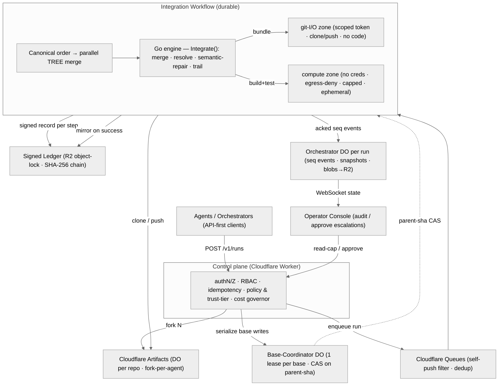
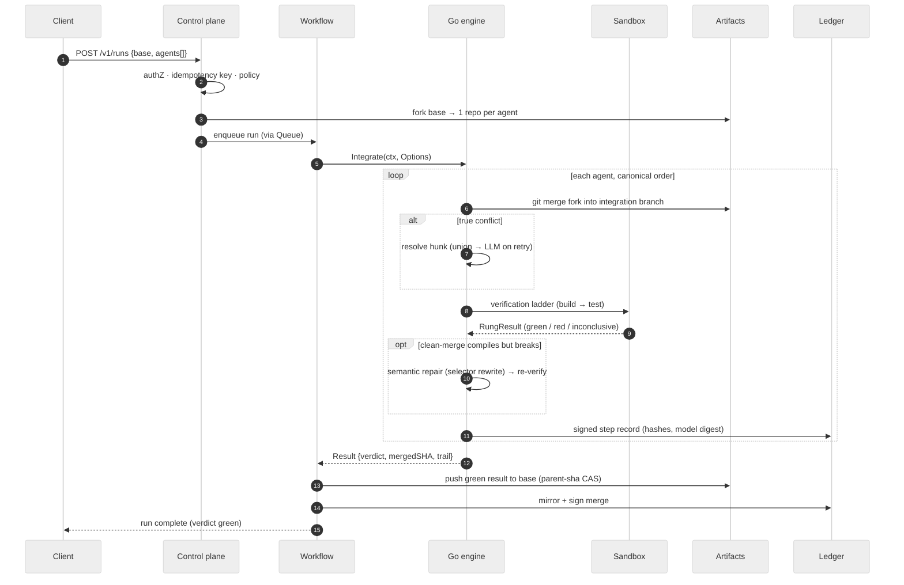
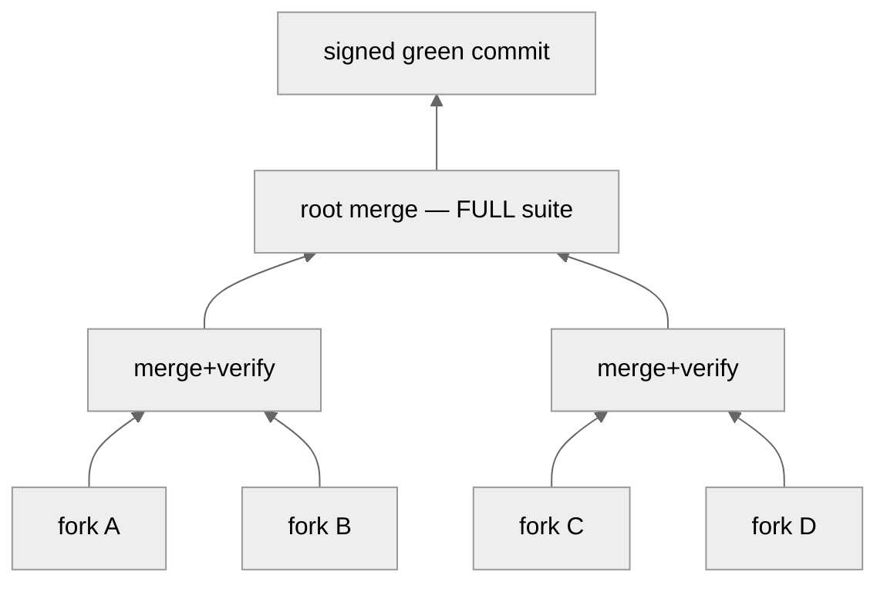

# Braid — Production Architecture

> Test-verified multi-agent merge on Cloudflare Artifacts.
> **Thesis: composition, not selection.** A swarm of agents each do a piece of one task on their own
> fork; Braid merges their work into one codebase and *proves* it with the project's real tests —
> instead of making a human pick one winner and discard the rest.
>
> The product is a **correctness, determinism & trust engine**. Cloudflare Artifacts already solved
> storage (a Durable Object per repo). Braid's engineering goes into the **fan-in**: merging N
> divergent forks deterministically, verifying every step in a sandbox, and recording tamper-evident
> provenance.
>
> **Legend used throughout:** ✅ **Built in Go — runnable today** · 🟠 **Designed — not yet built** ·
> 🟡 **Partial** (hackathon TS exists, to be productionised). Companion docs: `PRODUCTION_PLAN.md`
> (deep research + C1–C22 critique), `GO_MIGRATION_PLAN.md` (the brain port), `status.md` (handoff).
> Visual version of this doc: a rendered-diagram artifact (see `status.md`).

---

## 0. New-user journey — "I have a repo, I want changes" (plain English)

This is the whole system from the point of view of someone bringing their own code. Follow the money
all the way through.

> **Scenario:** Priya has a web service in a Git repo. She wants three improvements at once — input
> validation, rate limiting, and updated docs — and she wants them done by a swarm of AI agents and
> merged back *safely*, without her babysitting it.

**Step 1 — She brings her repo in.** Priya pushes (or imports) her repo onto the platform. Under the
hood it becomes a **Cloudflare Artifacts repository**, which is literally one Durable Object — a tiny
isolated server that *is* her repo and speaks Git. This is her **base**. 🟠

**Step 2 — She opens a run.** She (or her orchestrator) calls `POST /v1/runs` and says: "base =
my repo, and here are the tasks for the agents." The **control plane** checks she's allowed, stamps
an idempotency key so a retry can't double-charge or double-run, and records the run. 🟠

**Step 3 — Each agent gets its own copy.** The platform **forks** her base once per agent. Forking on
Artifacts is cheap and instant (each fork is its own Durable Object). Now agent-1, agent-2, and
agent-3 each have a private sandbox copy of her code. They never touch her real repo, and they can't
step on each other. 🟠

**Step 4 — Agents do their work in isolation.** Each agent edits its own fork and pushes its branch.
Crucially, agent code runs in the **untrusted compute zone** — no credentials in the room,
network locked down, strict CPU/memory/time limits. Even a malicious or buggy agent has nothing to
steal and nowhere to call. 🟠 *(In the demo today the agents are scripted diffs; the merge engine
treats them identically to real agents.)*

**Step 5 — Braid pulls everything together (the fan-in).** When the agents are done, a durable
**Workflow** wakes up and hands the forks to the **Go merge engine** — this is the part that runs
today. It takes the agents in a fixed, content-hash order (never "whoever finished first") so the
result is always reproducible. ✅

**Step 6 — Merge, one agent at a time.** For each agent's branch:
- If an agent only touched files nobody else touched → **Git auto-merges it. No AI involved.** ✅
- If two agents edited the *same* function (e.g. both changed `getUser`) → that's a **true conflict**.
  Braid's **resolver** composes both changes (keep validation *and* rate limiting). The cheap
  deterministic "union" merge is tried first; only if that fails does it escalate to an LLM (Cloudflare
  Workers AI or Claude) — and even then the LLM's output is never trusted on its word. ✅

**Step 7 — Prove it, cheapest check first (the verification ladder).** After every merge, the result
climbs a ladder and stops at the first failure:
1. **Structural guards** — the merge is *forbidden* from editing test files or lowering coverage (so
   "delete the test to make it pass" is impossible). 🟡
2. **Build / typecheck** — does it even compile? ✅
3. **Semantic check & auto-repair** — catches the sneaky case where code merges cleanly but is broken
   (agent-A renamed a function, agent-B still calls the old name). Braid detects the dangling reference
   and rewrites it automatically. ✅
4. **Run the real tests** — the actual test suite, in the sandbox. The full suite always runs at the
   final step so a shortcut can't fake a green. ✅

If the tests go red, Braid re-resolves with the failure fed back, up to a bounded number of retries.

**Step 8 — When agents genuinely can't coexist.** Sometimes two changes are mutually exclusive. Braid
doesn't force a nonsense merge — it emits an `incompatible` verdict and applies a **policy**: the
default *keeps both and flags a human* (drops nothing); an opt-in mode picks a winner by priority. The
discarded option is recorded, never silently lost. ✅

**Step 9 — Land it safely.** Once the merged tree is green, the token-holding **git-I/O zone** (a
separate, credentialed zone that never runs agent code) pushes the result back to Priya's base. A
**Base-Coordinator** ensures only one integration writes to her base at a time and uses a
compare-and-swap on the parent commit, so two runs can't clobber each other. 🟠

**Step 10 — She gets proof, not promises.** Every step wrote a **signed record** to an external,
tamper-evident ledger: what went in (by content hash), how each conflict was resolved, which model
version, the test results. Priya sees a `.braid/trail.json` provenance trail and a green verdict with a
merged commit SHA. Her operator console streams all of this live over WebSocket as it happens. ✅ (trail
today) / 🟠 (external signed ledger + live console in prod).

**The one-line version:** *Upload your repo → it becomes an isolated Cloudflare repo → each agent gets
a cheap private fork → agents edit in a locked-down sandbox → Braid merges them in a fixed order,
composing real conflicts → it re-runs your actual tests at every step and auto-repairs clean-but-broken
merges → only a green, signed result lands back on your repo, with a full audit trail.*

---

## 1. Topology — the production system, end to end

Agents and orchestrators are the customers; humans are operators and approvers, never on the per-merge
critical path.



**Two-zone execution — the core security idea:**

| Compute zone — **UNTRUSTED** 🟠 | git-I/O zone — **TRUSTED** 🟠 |
|---|---|
| Runs agent code, resolver output, and the test suite | Holds the short-lived Artifacts token; moves trees only |
| No credentials in the process — nothing to exfiltrate | Single-operation-scoped, JIT-minted token |
| Default-deny egress (allowlisted registry mirror only) | Clone / push only — never executes untrusted code |
| Hard CPU / mem / pids / disk / wall-clock caps | Merged tree crosses zones as a content-addressed bundle |
| microVM / gVisor-class isolation, ephemeral per job | Tokens never enter the compute zone |

---

## 2. Data flow — one run, step by step

Steps 5–14 are the live Go `Integrate()` loop; the bracketing steps are the designed control plane.



---

## 3. The verification ladder — the heart

"Green" is never a single exit code. Each merge climbs a cheapest-first ladder and short-circuits on
the first failure. Tests are **immutable merge inputs** — the engine is structurally forbidden from
editing them or reducing coverage, which kills the "delete the test to pass" shortcut.

| Rung | What it does | Status |
|---|---|---|
| **0 — Contract-first decomposition** | Each subtask carries a machine-readable acceptance spec + tests, frozen and content-hashed *before* any code is written. The feature's test exists before its code. | 🟠 Planned |
| **1 — Structural guards** | Deterministic, pre-execution. Resolution confined to the conflict region; reject any edit to test files or coverage/test-count regression; AST bounds on LLM output. `ladder.StructuralGuards` | 🟡 Partial (Go) |
| **2 — Build + typecheck + lint** | Cheap; catches most semantic breakage without running anything. In Go a clean-but-broken cross-package reference surfaces here as a compile error. `ladder.GoBuildVerifier` | ✅ Built (Go) |
| **3 — Semantic-conflict detection & repair** | Symbol/dependency graph of base vs fork. If A renames a symbol B still references — with no textual conflict — force the pair into repair. Go: build-diagnostic attribution + selector rewrite. `semantic.SemanticConflicts` · `RepairRename` | ✅ Built (Go) |
| **4 — Test execution** | Impacted tests at internal nodes; **full suite always at the root** so a selection miss can't fake a final green. Flakes quarantined, treated as *inconclusive*. `ladder.GoTestVerifier` (parses `go test -json`) | ✅ Built (Go) |
| **5 — Contract / metamorphic preservation** | Golden snapshots of each agent's observable behavior on its own fork; assert the merged system still satisfies *every* agent's contract. Proves "both features survived." | 🟠 Planned |

**Incompatibility path — union is not a law.** When two agents' contracts are provably mutually
exclusive, or the merge stays red after bounded retries, the engine emits an `incompatible` verdict and
applies a policy: `EscalatePolicy` (default — keep both, flag a human, drop nothing) or
`PickWinnerPolicy` (opt-in — drop the loser by priority), recording the discarded candidate. ✅ Built (Go)

---

## 4. Deterministic parallel fan-in

The bottleneck at scale is not storage — it's the fan-in (merge + re-run tests). N agents fold as a
**pairwise tree** of depth O(log N), each node an independent, sandboxed, cacheable job, ordered by
content hash so the result never depends on arrival order.



Reproducibility is a tested invariant: LLM calls at temperature 0 with a pinned model digest, a
resolution cache keyed by `hash(base + ours + theirs + context + model-digest + prompt-version)`, and CI
that merges the same inputs twice and asserts identical output hashes. 🟠 Planned — the Go engine today
folds agents sequentially.

---

## 5. API surface

### Control-plane REST API 🟠 Planned

| Method · Path | Purpose | Auth |
|---|---|---|
| `POST /v1/runs` | Open an integration run over a base ref + N agent forks; returns a run id + capability token. | Org API key, idempotency key |
| `GET /v1/runs/:id` | Run status, verdict, merged SHA, trail reference. | Read capability |
| `POST /v1/runs/:id/cancel` | Abort an in-flight run; releases the base lease. | Run capability |
| `POST /v1/runs/:id/approve` | Human resolution of an escalated incompatibility (operators only). | Approve capability |
| `POST /runs/:id/event` | Pipeline posts a structured progress event (reduced into run state). | Per-run HMAC |
| `GET /runs/:id/ws` | Console subscribes for live state over WebSocket (seq-numbered, replay-on-gap). | Read capability |
| `GET /runs/:id/state` | Snapshot of run state for polling / audit. | Read capability |

The existing hackathon Worker already implements `/runs/:id/{event,ws,state}` and `/reset` against an
Orchestrator DO; the `/v1/*` run lifecycle, auth, and capability tokens are the production additions.

### Go engine interfaces ✅ Built — runnable

```go
// internal/merge — the integration loop (the spine)
func Integrate(ctx context.Context, o Options) (Result, error)
  // Options{ RepoDir, Baseline, Agents[], Resolver, Ladder, Policy, MaxRetries, Emit }
  // Result { MergedSHA, Trail, Green, Verdict }

// internal/ladder — the verification ladder
type Verifier interface { Verify(ctx, repoDir) (RungResult, error) }
func (l *Ladder) Run(ctx, repoDir, baselineRef) (LadderResult, error)
  // GoBuildVerifier (rung 2) · GoTestVerifier (rung 4) · StructuralGuards (rung 1)

// internal/resolver — pluggable conflict resolution
type Resolver interface { Resolve(ctx, ResolveInput) (ResolveOutput, error) }
type OptionalResolver interface { Resolver; Available() bool; Name() string }
  // UnionResolver · WorkersAIResolver · ClaudeResolver · HybridResolver

// internal/semantic — clean-merge-but-broken detection & repair
func SemanticConflicts(repoDir, buildDiag) ([]BrokenRef, error)
func RepairRename(repoDir, pkg, oldName, newName) (int, error)

// internal/policy — incompatibility decisions
type Policy interface { Decide(Context) Decision; Name() string }
  // EscalatePolicy (default) · PickWinnerPolicy{Order}
```

### Run it now

```bash
# full pipeline on a seeded Go /users API — merges 3 agents, proves green
go run ./cmd/braid demo
go run ./cmd/braid demo --repo /tmp/mine --keep   # keep the repo to inspect
cat /tmp/mine/.braid/trail.json                    # the provenance trail

# optional live LLM resolver (escalated on retry)
BRAID_WORKER_URL=…   # Cloudflare Workers AI
ANTHROPIC_API_KEY=…  # Claude
```

---

## 6. Status matrix — built vs. planned

| Component | Role | Status |
|---|---|---|
| `internal/merge` | Integration loop: merge · resolve · semantic-repair · trail | ✅ Built (Go) |
| `internal/ladder` | Verification rungs 1–4 (guards, build, test) | ✅ Built (Go) |
| `internal/semantic` | Clean-merge breakage detection + selector-rewrite repair | ✅ Built (Go) |
| `internal/resolver` | Union + Workers AI + Claude + hybrid conflict resolution | ✅ Built (Go) |
| `internal/policy` | Escalate / pick-winner incompatibility policy | ✅ Built (Go) |
| Rung 0 · Rung 5 | Contract-first test authoring; metamorphic contract preservation | 🟠 Planned |
| Two-zone sandbox | Untrusted compute zone + credentialed git-I/O zone | 🟠 Planned |
| Control-plane Worker | authN/Z · RBAC · idempotency · policy · cost governor | 🟠 Planned |
| Base-Coordinator DO | One lease per base; CAS on parent-sha (no write races) | 🟠 Planned |
| Queues + Workflow | Self-push filtering, dedup, durable parallel tree merge | 🟠 Planned |
| Signed ledger | External, append-only, SHA-256 chain, object-locked R2 | 🟠 Planned |
| Orchestrator DO | Seq-numbered events, snapshots, blobs→R2 | 🟡 Partial (TS) |
| Operator console | Run list, live view, escalation review, audit lineage | 🟡 Partial (TS) |
| Determinism & cache | Canonical order, temp-0, pinned model, resolution cache | 🟠 Planned |

---

*Grounded in the live Go module (`github.com/KC1706/braid`) and `PRODUCTION_PLAN.md` §4–6. Status colors
mark implementation state, not importance.*
